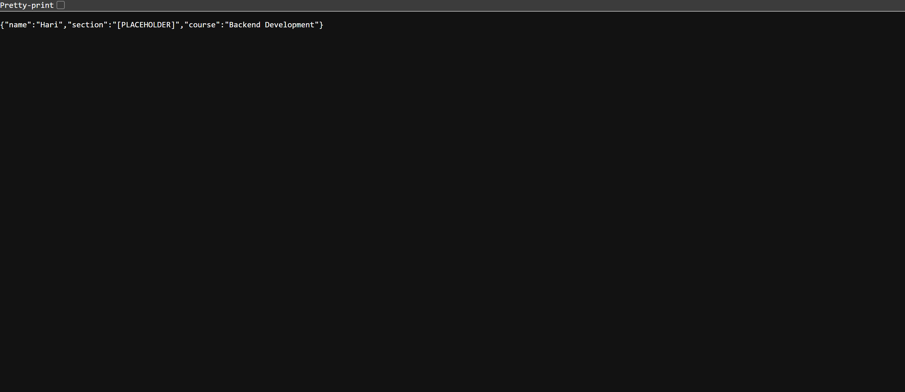
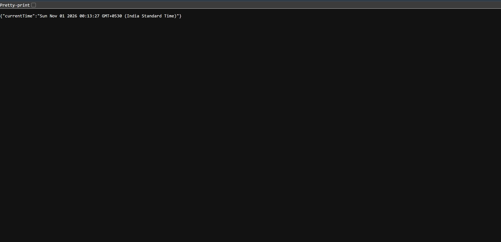
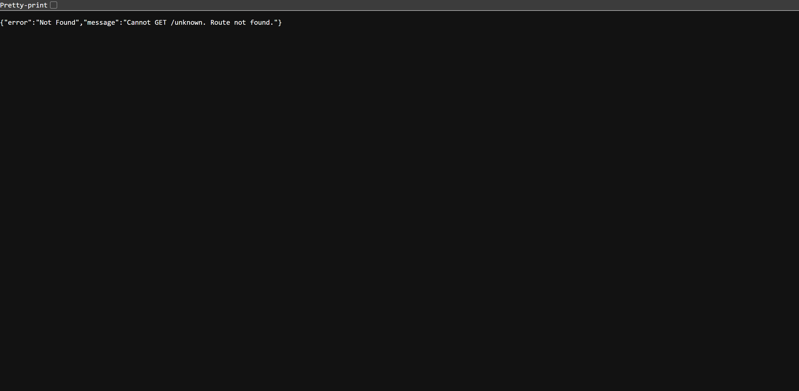

# Lab 1: Node.js and Express Server

**Course:** Backend Development Fundamentals  
**Academic Year:** II Year, Term II  
**Institution:** Aurora Deemed to be University  
**Faculty:** Mr Sai Siva Teja Chintakrindi  

---

## 1. Student Information
- **Name:** Annamaneni Vivardhini
- **Registration Number:** 252U1R1014
- **Section:** CSE-2A

---

## 2. Deployment URL
- **Live Deployment URL:** [https://bogamhariprasad.onrender.com](https://bogamhariprasad.onrender.com)

---

## 3. Project Description
This repository contains the implementation of **Lab 1: Node.js and Express Server** for the Backend Development Fundamentals course. 

The lab introduces two foundational approaches to creating backend web servers in Node.js:
1. **Native HTTP Server (`server-http.js`):** Implemented using Node.js's built-in `http` module without any third-party libraries.
2. **Express Server (`server.js`):** Implemented using the Express.js framework, featuring modular REST routing, environment-based port configuration for deployment, and centralized 404 error handling middleware.

---

## 4. Installation Instructions

### Prerequisites
- [Node.js](https://nodejs.org/) (v18 or higher recommended)
- `npm` (Node Package Manager)

### Steps
1. Navigate to the `lab-01` directory:
   ```bash
   cd lab-01
   ```
2. Install dependencies:
   ```bash
   npm install
   ```

---

## 5. Execution Commands

The project defines the following npm scripts in `package.json`:

| Command | Action | Description |
| :--- | :--- | :--- |
| `npm start` | `node server.js` | Starts the Express server on port 3000 (or `process.env.PORT`) |
| `npm run native` | `node server-http.js` | Starts the native Node.js HTTP server on port 3000 |
| `npm test` | `node test.js` | Runs the automated test suite verifying all server endpoints |

### Direct Node.js Execution:
- To run the native HTTP server:
  ```bash
  node server-http.js
  ```
- To run the Express server:
  ```bash
  node server.js
  ```
- To run the test suite:
  ```bash
  node test.js
  ```

---

## 6. API Endpoints Table

### Express Server (`server.js`)

| HTTP Method | Endpoint | Purpose | Expected Status | Sample Response Body |
| :--- | :--- | :--- | :---: | :--- |
| **GET** | `/` | Lab welcome message | `200 OK` | `Welcome to Backend Development Lab 1` |
| **GET** | `/about` | Student profile data in JSON format | `200 OK` | `{"name":"Bogam Hari Prasad","section":"CSE-2A","course":"Backend Development Fundamentals"}` |
| **GET** | `/time` | Current date and time using `new Date()` | `200 OK` | `{"currentTime":"Sun Nov 01 2026 00:30:36 GMT+0530 (India Standard Time)"}` |
| **GET** | `/unknown` (any undefined route) | Catch-all 404 error handler | `404 Not Found` | `{"error":"Not Found","message":"Cannot GET /unknown. Route not found."}` |

### Native HTTP Server (`server-http.js`)

| HTTP Method | Endpoint | Purpose | Expected Status | Response Body |
| :--- | :--- | :--- | :---: | :--- |
| **GET** | `/` | Hello message | `200 OK` | `Hello` |

---

## 7. Screenshots

### 1. Native HTTP Server (`server-http.js` on port 3000)


### 2. Express Server - Welcome Route (`GET /`)


### 3. Express Server - About Route (`GET /about`)


### 4. Express Server - Time Route (`GET /time`)


### 5. Express Server - 404 Route Not Found (`GET /unknown`)


---

## 8. Problems Faced and Solutions

### Problem 1: PowerShell Script Execution Restrictions (`npm.ps1`)
- **Issue:** On Windows systems, running `npm` commands directly in PowerShell can trigger an execution policy error: `npm.ps1 cannot be loaded because running scripts is disabled on this system`.
- **Solution:** Invoked `npm.cmd` instead of `npm`, or set the execution policy for the current process using `Set-ExecutionPolicy -Scope Process -ExecutionPolicy Bypass`.

### Problem 2: 404 Middleware Intercepting Valid Routes
- **Issue:** If a catch-all 404 middleware is declared before route handlers in Express, valid routes like `/about` or `/time` are immediately intercepted and return 404.
- **Solution:** Ensured the catch-all `app.use((req, res) => ...)` middleware is strictly placed at the end of `server.js`, after all valid `app.get(...)` declarations.

### Problem 3: Port Configuration for Cloud Deployment
- **Issue:** Cloud hosting providers (e.g., Render, Railway) assign a dynamic port via environment variables at runtime. Hardcoding `port = 3000` causes deployment health checks to fail.
- **Solution:** Configured the port dynamically using `process.env.PORT || 3000`, allowing local development to default to `3000` while honoring the cloud environment's assigned port.
